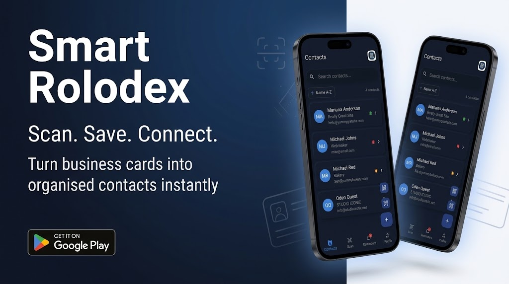
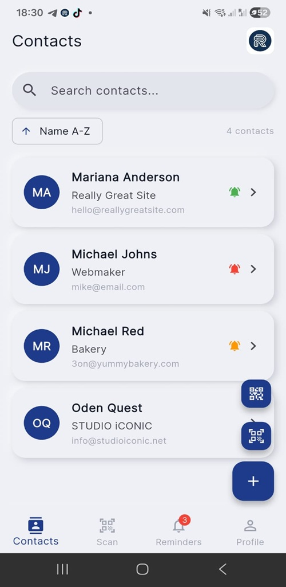
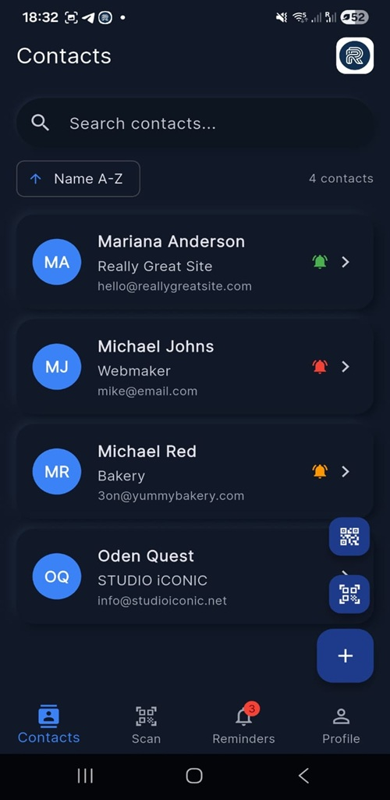
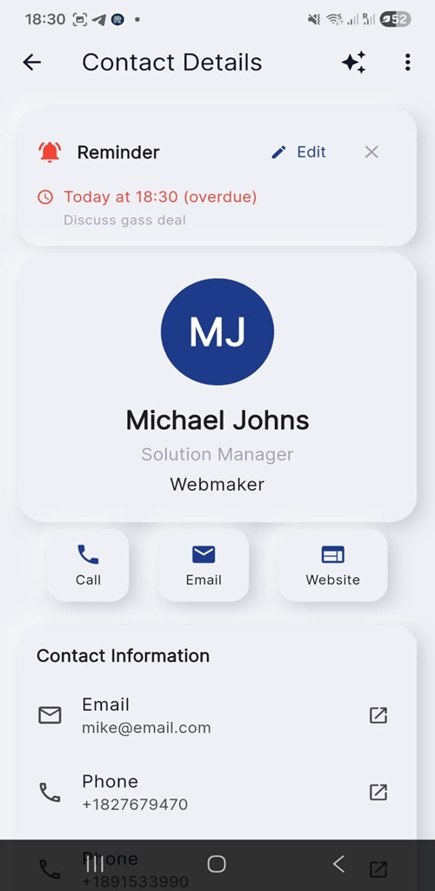
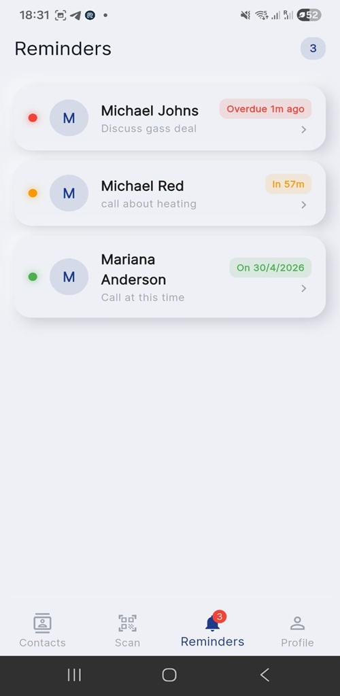
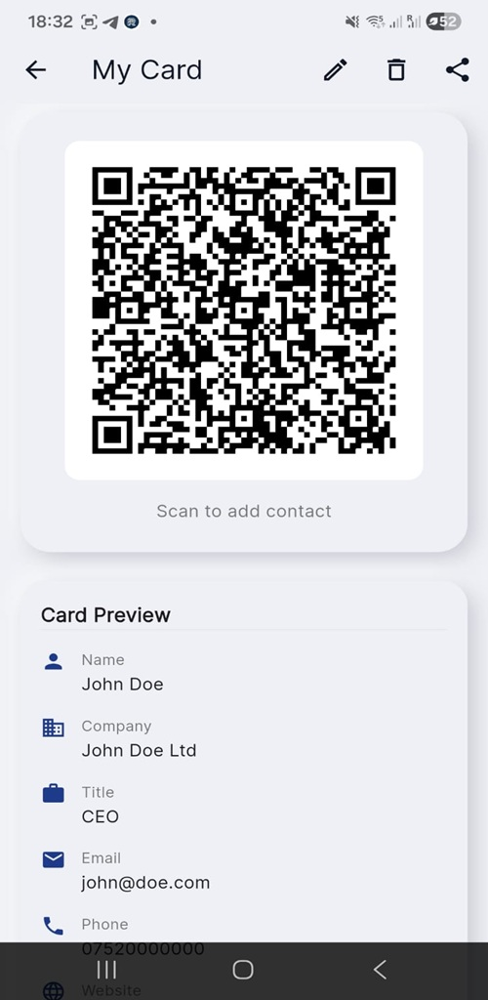

# Smart Rolodex

**A professional contacts and networking app for Android and iOS.**
Scan a business card, save the contact, set a reminder to follow up, and share your own card by QR code.

🟢 **Live on Google Play:** [Get Smart Rolodex](https://play.google.com/store/apps/details?id=com.smartrolodex.smart_rolodex)
🌐 **Website:** [smartrolodex.molaton.org](https://smartrolodex.molaton.org)

> The source code is private. This page shows what the app does, how it is built and how I tested it.

---

## Screens

| Contacts (light) | Contacts (dark) | Contact details | Reminders | QR card |
|---|---|---|---|---|
|  |  |  |  |  |

---

## Features

- **Business-card scanning (OCR):** reads both sides of a card on the device. It uses Apple Vision on iOS and Google ML Kit on Android. It merges the two sides and removes duplicate fields.
- **AI card extraction and contact research (Premium):** sends a card image to an AI model through a Supabase Edge Function, and writes a short background summary for a contact.
- **QR exchange:** make a personal QR card, or scan another person's card to add them at once.
- **Follow-up reminders:** set a reminder on a contact and see what is overdue.
- **Offline cache and live sync:** contacts are cached on the device and sync in real time.
- **Security:** sign-in with Supabase Auth, biometric login per user, and Row Level Security on every table.
- **Light and dark themes** with a neumorphic design.
- **Free and Premium tiers:** free users see ads with frequency limits; Premium users see none.

---

## Tech stack

| Layer | Technology |
|---|---|
| App | Flutter, Riverpod |
| Backend | Supabase (Auth, Database, Storage, Edge Functions, Realtime) |
| AI | OpenAI models through Supabase Edge Functions |
| On-device OCR | Apple Vision (Swift), Google ML Kit (Kotlin) |
| Local storage | Hive, flutter_secure_storage |
| Ads | Google AdMob |

The app uses a clean architecture: data, domain, presentation and services layers.

---

## How I tested it

<!-- Fill in with what you actually did. Keep it true. Examples to choose from:
- Number of test cases you wrote, and the areas they cover
- Devices and Android/iOS versions you tested on
- Edge cases: poor card photos, one-sided cards, offline use, switching users with biometrics on
- Bugs you found and fixed before release
- Google Play pre-launch report or closed testing track
Make each line below visible only if you really did it:
- Tested business-card scanning with front-only and front-and-back cards.
- Tested biometric login when a different user signs in on the same phone.
- Tested ad frequency rules for free users and the "no ads" rule for Premium users.
-->

- Released through the Google Play review process.
